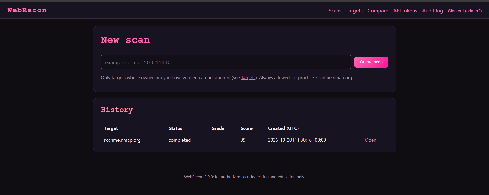
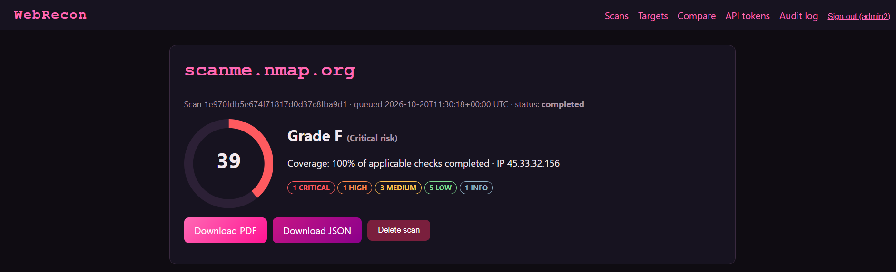

# WebRecon

[](https://github.com/nooralshamasneh/WebRecon/actions/workflows/ci.yml)
[](LICENSE)

Authorized web reconnaissance and security-posture assessment. WebRecon scans a domain or IP you own, maps every
finding to the **OWASP Top 10** (and ASVS), grades it with a documented severity model, and keeps a history you can
compare over time through a web UI and a REST API.

> **For authorized testing and education only.** WebRecon refuses to scan a target until you prove you control it. Read [SECURITY.md](SECURITY.md).




## What it checks

| Area                | Checks                                                                                                                                       |
| ------------------- | -------------------------------------------------------------------------------------------------------------------------------------------- |
| **Network**         | nmap service/version detection on a pinned IP (socket fallback), exposed Telnet/FTP/SMB/RDP/databases                                        |
| **HTTP**            | HSTS, CSP (and weak CSP), clickjacking, nosniff, Referrer/Permissions-Policy, version disclosure, cookie flags, CORS, HTTP to HTTPS redirect |
| **TLS**             | Certificate validity/expiry, chain trust, hostname match, key size, signature hash, TLS 1.0/1.1/1.2/1.3 support, weak cipher families        |
| **E-mail**          | SPF (policy, lookup limit, duplicates), DMARC (policy, reporting), DKIM (common selectors)                                                   |
| **Exposure**        | `.git`, `.env`, debug pages, `.DS_Store`, admin paths, with soft-404 / catch-all filtering                                                   |
| **Discovery**       | Subdomains from 5 passive sources + wordlist brute force with wildcard-DNS awareness                                                         |
| **Fingerprinting**  | ~35 signatures (servers, CDN/WAF, CMS, frameworks, JS libraries) with versions                                                               |
| **Vulnerabilities** | CVE correlation through the NVD API from detected product versions (marked _tentative_)                                                      |

Findings, severities and OWASP/ASVS mapping: [docs/OWASP_MAPPING.md](docs/OWASP_MAPPING.md). Scoring: [docs/SCORING.md](docs/SCORING.md).

## Quick start

### Docker (recommended)

```bash
git clone https://github.com/nooralshamasneh/WebRecon.git && cd WebRecon
cp .env.example .env            # set WEBRECON_ADMIN_PASSWORD (12+ characters)
docker compose up --build
```

Open http://127.0.0.1:8080 and sign in as `admin`.

### Local

Requirements: Python 3.10+, [nmap](https://nmap.org/download.html) on your `PATH` (optional; without it WebRecon falls back to a basic TCP scan).

```bash
python -m venv .venv && source .venv/bin/activate      # Windows: .venv\Scripts\activate
pip install -r requirements.txt
python -m flask --app webrecon create-user admin --role admin   # prompts for a password
python -m webrecon
```

## Authorization: proof of ownership

Only these targets can be scanned:

1. `scanme.nmap.org` (explicitly permits scanning; configurable with `WEBRECON_PUBLIC_TARGETS`).
2. Targets you verified under **Targets**, by **either**
   - a DNS TXT record: `_webrecon-challenge.<domain>  TXT  "webrecon-verification=<token>"`, or
   - a file at `/.well-known/webrecon-verification.txt` containing the token.

Verifying a domain also authorises its subdomains for 30 days. Private, loopback and reserved addresses are always refused.

### Lab mode (isolated environments only)

For a lab you fully control you can switch the ownership requirement off **for the current terminal session only**:

```powershell
$env:WEBRECON_REQUIRE_VERIFICATION="0"      # Linux/macOS: export WEBRECON_REQUIRE_VERIFICATION=0
python -m webrecon
```

Never enable it on a shared or internet-facing instance: it removes the protection that stops users scanning systems they do not own.

## REST API

```bash
curl -H "Authorization: Bearer $TOKEN" -H "Content-Type: application/json" \
     -d '{"target":"scanme.nmap.org"}' http://127.0.0.1:8080/api/v1/scans
```

Scan history, comparison between scans, PDF reports and ownership challenges are available over the API: see [docs/API.md](docs/API.md).

## Configuration

| Variable                                          | Default              | Purpose                                                                |
| ------------------------------------------------- | -------------------- | ---------------------------------------------------------------------- |
| `WEBRECON_HOST` / `WEBRECON_PORT`                 | `127.0.0.1` / `8080` | Bind address                                                           |
| `WEBRECON_DATA_DIR`                               | `instance`           | Database and secret key                                                |
| `WEBRECON_SECRET_KEY`                             | generated            | Session signing key                                                    |
| `WEBRECON_HTTPS`                                  | `0`                  | `1` behind HTTPS: Secure cookies and HSTS                              |
| `WEBRECON_BEHIND_PROXY`                           | `0`                  | Trust `X-Forwarded-*` from one proxy                                   |
| `WEBRECON_ADMIN_USER` / `WEBRECON_ADMIN_PASSWORD` | unset                | Create the first admin on startup                                      |
| `WEBRECON_WORKERS`                                | `2`                  | Concurrent scans                                                       |
| `WEBRECON_REQUIRE_VERIFICATION`                   | `1`                  | Set `0` only in an isolated lab                                        |
| `WEBRECON_ALLOW_PRIVATE`                          | `0`                  | Allow private targets (lab only)                                       |
| `WEBRECON_PUBLIC_TARGETS`                         | `scanme.nmap.org`    | Targets that need no verification                                      |
| `NVD_API_KEY`                                     | unset                | Faster NVD lookups (free key)                                          |
| `WEBRECON_NVD` / `WEBRECON_PASSIVE_SOURCES`       | `1`                  | Set `0` to stay offline                                                |
| `WEBRECON_WORDLIST`                               | bundled (~490 names) | Path to a larger list, e.g. SecLists `subdomains-top1million-5000.txt` |

## Architecture

Flask app, SQLite, a database-backed job queue with worker threads and live progress, and independent scan modules that
all connect to one pinned IP per scan. Details: [docs/ARCHITECTURE.md](docs/ARCHITECTURE.md).

## Development

```bash
pip install -r requirements-dev.txt
python -m unittest discover -s tests -t . -v      # 79 tests, no internet needed
python -m ruff check .
```

CI runs lint, the tests on Python 3.10-3.13, `pip-audit`, and a Docker build with a smoke test.

## Known limitations

- CVE matching is version-based and can include false positives (distribution back-ports). Those findings are _tentative_ and count half in the score.
- TLS protocol and cipher probing depends on what the scanner's local OpenSSL can offer; probes it cannot perform are reported as _untested_, not as "safe".
- DKIM selectors cannot be enumerated: only common names are tried, so "not found" is inconclusive.
- Run a single process: queue workers and rate limiters are per process. Put a TLS reverse proxy in front before exposing the app.
- Mappings use OWASP Top 10 **2025** and ASVS **4.0.3** (constants in `webrecon/findings.py`).
- Dependency updates: regenerate `requirements.lock` in a clean virtualenv (on Windows PowerShell use `pip freeze | Set-Content -Encoding ascii requirements.lock`; a plain `>` writes UTF-16).

## License

[MIT](LICENSE) © 2026 Noor Alshamasneh
